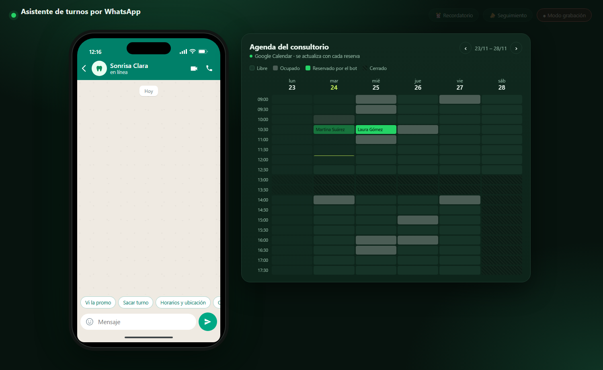
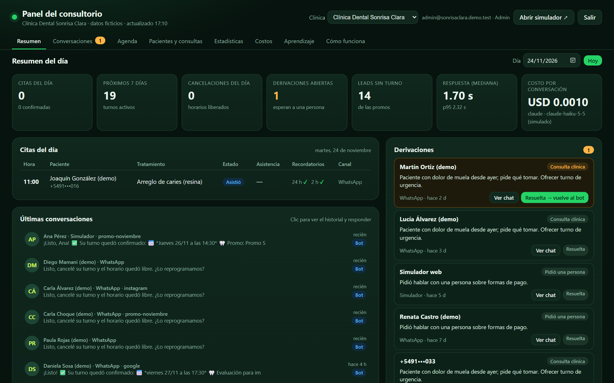
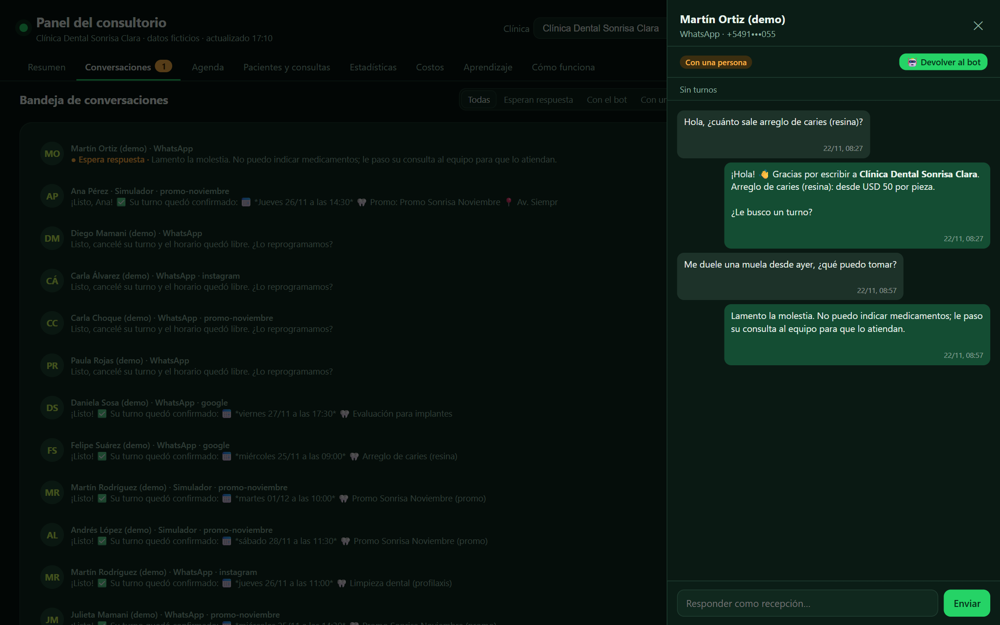
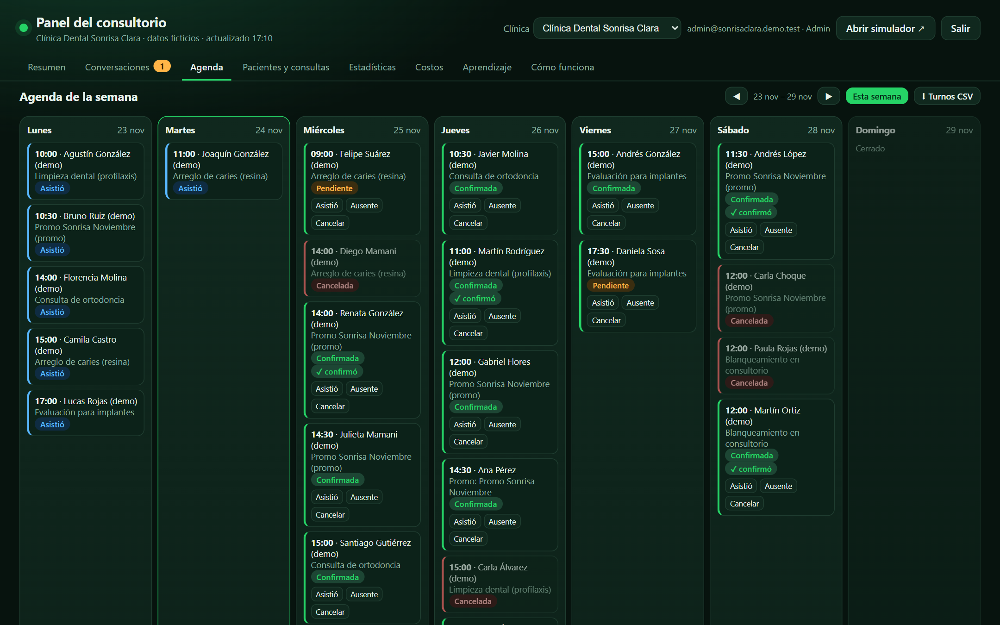
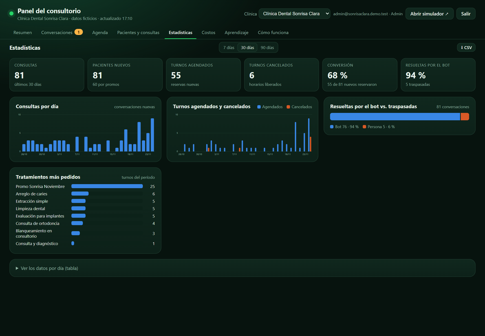
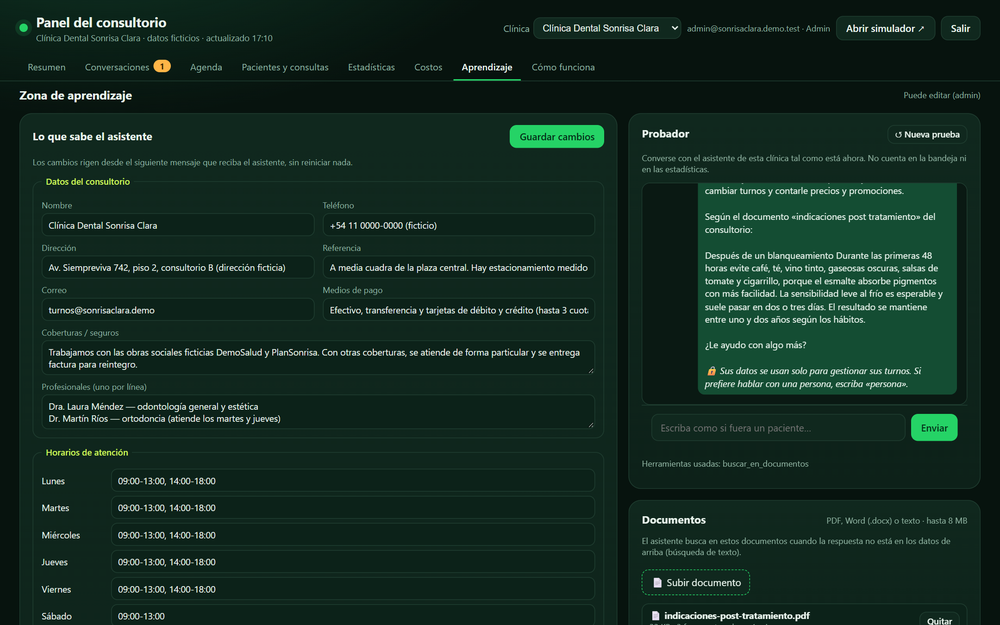
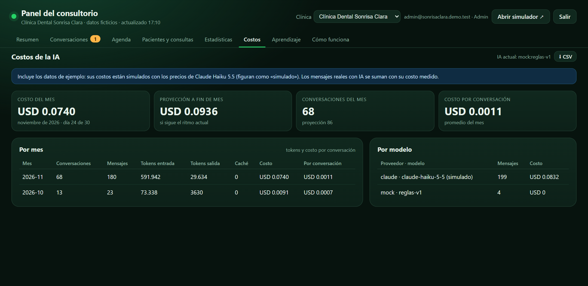
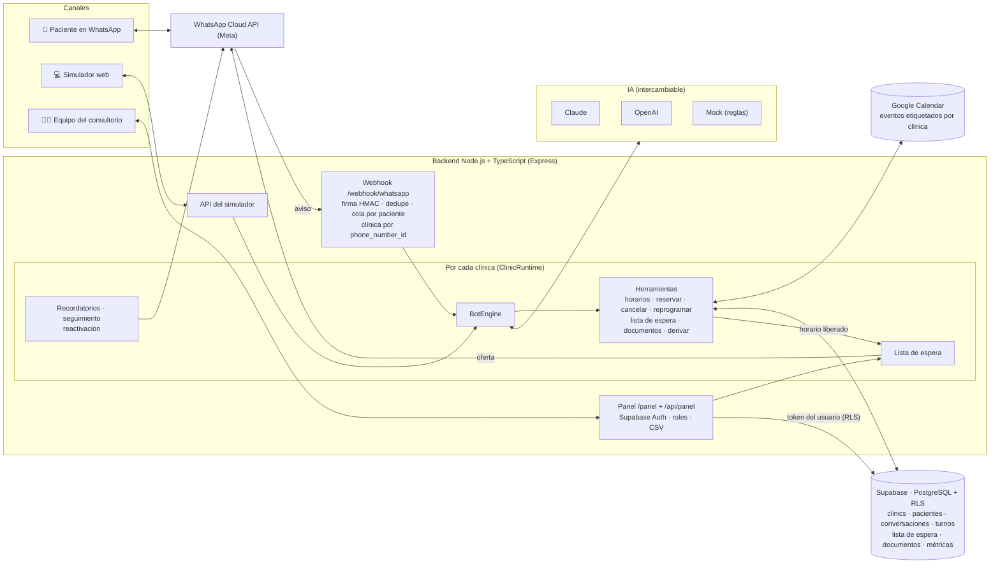
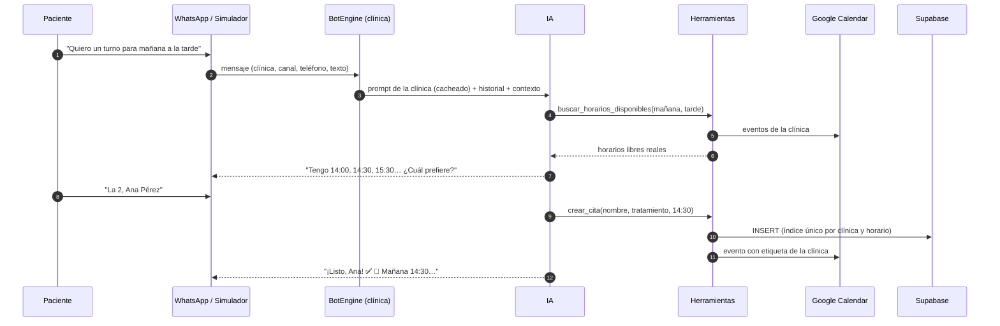
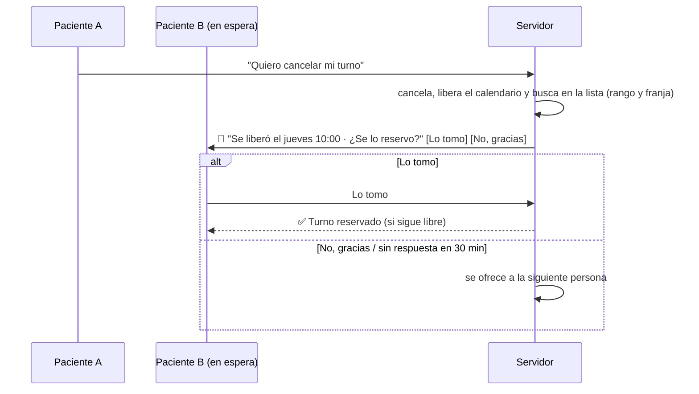

# Asistente de WhatsApp con IA para clínicas dentales (MVP multiempresa)

Plataforma de atención por **WhatsApp + IA** para consultorios odontológicos:

- **Responde** consultas con la información de cada clínica y sus documentos.
- **Agenda** sobre la disponibilidad real de **Google Calendar**, sin dobles reservas.
- **Recuerda** los turnos con botones para confirmar o cancelar.
- **Ofrece los huecos** que deja una cancelación a la lista de espera.
- **Reactiva** a los pacientes que no vuelven.
- **Deriva a una persona** con el contexto de la conversación.

Cada clínica tiene sus datos separados en **Supabase con RLS** y un **panel** para su equipo, con roles admin y recepción: conversaciones, agenda, pacientes, estadísticas, costos de la IA y una zona de aprendizaje con probador.

> **Proyecto de portafolio con datos ficticios.** No es un servicio médico ni un producto en producción.



---

## Contenido

[Qué hace](#qué-hace) · [Capturas](#capturas) · [Arquitectura](#arquitectura) · [Multidoctores y calendarios](#multidoctores-y-calendarios) · [Seguimientos y recordatorios](#seguimientos-y-recordatorios) · [Demo pública y recorrido](#demo-pública-y-recorrido-guiado) · [Multiempresa y seguridad](#multiempresa-y-seguridad) · [Stack y decisiones](#stack-y-decisiones) · [Instalación](#instalación-windows--powershell) · [Variables de entorno](#variables-de-entorno) · [Entorno de pruebas y producción](#entorno-de-pruebas-y-producción) · [Uso](#uso) · [Documentos y búsqueda](#documentos-y-búsqueda) · [Pruebas](#pruebas) · [Costos](#costos) · [Datos de ejemplo](#datos-de-ejemplo) · [Despliegue](#despliegue) · [Estructura](#estructura) · [Seguridad y privacidad](#seguridad-y-privacidad)

## Qué hace

| Función | Cómo |
|---|---|
| Responde consultas | Con el conocimiento de la clínica (tratamientos, precios, horarios, coberturas, preguntas frecuentes) y, si no está ahí, buscando en los **documentos** que subió el consultorio. Sin consejos médicos. |
| Agenda turnos | Pregunta la especialidad, luego el profesional si hay más de uno (o «el primero disponible»), y después el día y la hora. **Solo ofrece horarios libres** de ese profesional. Reserva, reprograma y cancela con herramientas validadas en el backend. |
| Varios profesionales | Cada uno con especialidad, tratamientos que realiza con su duración propia, color, horario semanal y excepciones (día, franja o vacaciones). Agenda con vista del día en una columna por profesional. |
| Evita la doble reserva | Por profesional: validación en el código **y** una restricción de exclusión en PostgreSQL que rechaza dos turnos activos del mismo profesional que se superpongan (aunque duren distinto). |
| Excepciones de agenda | Al cargar una ausencia, el panel lista los turnos afectados y ofrece avisar por el bot; el paciente toca **Reprogramar** o **Cancelar turno**. |
| Seguimientos y recordatorios | Reglas por clínica editables en el panel: 72, 24, 2 y 1 h antes del turno (o las que se agreguen), X días después, reactivación cada N días y seguimiento de leads. Cada una con texto, botones y plantilla; horario de silencio y sin envíos dobles. Por defecto, 24 h y 2 h con botones **Confirmo · Cambiar horario · Cancelar**. |
| Lista de espera | Si no hay horario, anota al paciente con su rango y franja. Cuando alguien cancela, le ofrece el hueco por WhatsApp (**Lo tomo · No, gracias**); si no responde a tiempo, pasa al siguiente. |
| Reactivación | Invita a un control a quien no viene hace 6 meses o más, como máximo una vez cada 90 días. |
| Seguimiento de leads | Escribe una vez a quien consultó por una promo y no agendó. |
| Menú inicial | Un saludo recibe un menú con botones (hasta 3 opciones) o una lista de WhatsApp (hasta 10), editable en Aprendizaje y sin costo de IA. |
| Pasar a una persona | Deriva con un resumen; desde la bandeja se toma la conversación, se pausa el bot o se devuelve al bot. |
| Bandeja tipo WhatsApp Web | Lista, chat y ficha del paciente en tres paneles. Cada conversación tiene un estado (**Espera respuesta, Con el bot, Con una persona, Pausada, Cerrada**), con filtros y contadores; cada mensaje muestra quién lo escribió. Se cierra sola por inactividad o al confirmar o cancelar un turno, y se reabre si el paciente vuelve a escribir. |
| Ficha del paciente | Nombre real (lo pide el bot y lo guarda con una herramienta), nombre de WhatsApp aparte, teléfono de contacto, notas y etiquetas. Los cambios se ven en el chat, la agenda y la lista de pacientes. |
| Multiempresa | Dos clínicas de ejemplo con datos, conocimiento, horarios y agenda separados; el webhook elige la clínica por el número de WhatsApp. |
| Panel del consultorio | Login con Supabase Auth, roles admin y recepción, selector de clínica, exportación a CSV para Excel. |
| Zona de aprendizaje | El admin edita lo que sabe el asistente y sube PDF o Word; el cambio rige desde el mensaje siguiente. Incluye un probador. |
| IA intercambiable | `LLM_PROVIDER=claude \| openai \| mock`. Si falta la clave, pasa solo al modo sin IA (reglas), que sirve para grabar demos. |

## Capturas

| | |
|---|---|
|  **Resumen:** citas del día, derivaciones, leads y rendimiento |  **Conversaciones:** bandeja con estado, «espera respuesta», tomar, pausar o devolver al bot |
|  **Agenda:** la semana con asistencia y cancelación (libera el calendario y ofrece el hueco) |  **Estadísticas:** consultas, turnos, conversión, bot vs persona, tratamientos |
|  **Aprendizaje:** conocimiento editable, documentos y probador |  **Costos:** tokens y USD por conversación, mes y proyección (solo admin) |

Las capturas se regeneran con `npm run capturas`: usa el entorno de pruebas con datos ficticios y Microsoft Edge sin ventana.

## Arquitectura



### Flujo de una reserva



### Lista de espera



## Multidoctores y calendarios

- **Profesionales** ([src/data/clinics/professionals.ts](src/data/clinics/professionals.ts), tabla `professionals`): especialidad, color, horario semanal (se cruza con el de la clínica), tratamientos que realiza con los minutos que le lleva cada uno, y calendario `google` o `interno`. Se editan en el panel (pestaña Profesionales, solo admin) y rigen desde el mensaje siguiente.
- **Disponibilidad** ([src/services/availability.ts](src/services/availability.ts)): un horario está libre para un profesional si cae en su horario, no lo toca una excepción, no se superpone con otro turno suyo (con la duración de ese tratamiento) y, si usa Google, tampoco con un evento de su calendario. «El primero disponible» combina a todos los que hacen el tratamiento y muestra cada hora una sola vez.
- **Excepciones** (tabla `professional_exceptions`): día completo, franja de un día o rango de vacaciones, con motivo. Bloquean esos horarios para el bot; los turnos que ya estaban se listan y se puede avisar a esos pacientes por el bot (plantilla `turno_reprogramar` si pasaron más de 24 h desde su último mensaje).
- **Lista de espera:** quien pidió un profesional solo recibe huecos de ese profesional; quien eligió «cualquiera», de cualquiera que haga su tratamiento.

**Calendarios en esta demo:** la Dra. Méndez (Sonrisa Clara) usa el Google Calendar real de `GOOGLE_CALENDAR_ID`; el resto de los profesionales, incluida toda la clínica Altamira, usa la agenda interna del sistema (la base de datos).

**En producción, cada profesional conecta su propio calendario** y el sistema lee solo ocupado/libre:
1. El profesional autoriza con OAuth de Google desde el panel, con un permiso de solo disponibilidad (por ejemplo, el alcance `calendar.freebusy`): el sistema no ve títulos ni pacientes de otros eventos, solo los bloques ocupados.
2. La disponibilidad consulta esos bloques (`freebusy.query`) además de los turnos de la base.
3. Los turnos que reserva el bot quedan en la base (fuente de verdad) y, si el profesional lo autoriza con permiso de escritura, también como evento en su calendario.

Conviene confirmar los alcances y el proceso de verificación de la app de Google en la documentación oficial antes de implementarlo; en esta demo no está implementado (la Dra. Méndez usa una cuenta de servicio compartida).

## Seguimientos y recordatorios

Pestaña **Seguimientos** del panel (edita el admin; recepción la ve). Las reglas se guardan por clínica en `clinics.settings` y el servicio de recordatorios ([src/bot/reminders.ts](src/bot/reminders.ts)) las lee en cada revisión (cada minuto), así que un cambio rige enseguida.

| Regla | Cuándo | Por defecto |
|---|---|---|
| Antes del turno | X horas antes (72, 24, 2, 1 o la que se agregue) | 24 h y 2 h activas; 72 h y 1 h cargadas pero apagadas |
| Después del turno | X días después de un turno con asistencia | 1 día, apagada |
| Reactivación | A quien no viene hace X días, repetida cada N días | 180 días, cada 90 |
| Lead de la promo | X horas después de que dejó de escribir sin agendar (una vez) | 20 h |

- **Texto y botones** editables, con campos que se completan solos: `{nombre}`, `{cuando}`, `{fecha}`, `{hora}`, `{tratamiento}`, `{profesional}`, `{clinica}`, `{direccion}`, `{promo}`, `{meses}`. Las reglas «antes» admiten un texto distinto si el paciente ya confirmó (sin botones).
- **Sin envíos dobles:** cada turno guarda las reglas ya enviadas u omitidas (`appointments.reminders_sent`). Si varias reglas caen juntas, sale solo la más cercana al turno; si el turno se reservó dentro de la ventana de una regla, esa se omite porque la confirmación de la reserva ya cumple esa función.
- **Horario de silencio** (por defecto de 21:00 a 08:00): los avisos esperan a que termine. Las ofertas de la lista de espera no esperan, porque el horario se puede perder. La duración de esas ofertas también se ajusta por clínica.
- **WhatsApp real:** si pasaron más de 24 h desde el último mensaje del paciente, el mensaje sale con la plantilla de Meta de la regla (`recordatorio_turno`, `seguimiento_post_turno`, `reactivacion_paciente`, `seguimiento_promo`): llega el texto de la plantilla con los datos del paciente, no el texto editado. Las plantillas se crean con `npm run wa:templates` y su estado se ve con `npm run wa:templates -- --status`.

## Demo pública y recorrido guiado

- **`/demo`**: página de presentación con el botón **Entrar al demo**. Cada visita recibe su propia **clínica temporal** (copia de la clínica de ejemplo con 30 días de datos ficticios) y entra al panel como admin, sin contraseña visible. Solo ve lo suyo y todo se borra solo a las `DEMO_HOURS` (24 h).
  - **Sesión:** con Supabase, un usuario **anónimo** de Supabase Auth con rol admin solo en su clínica, así la base lo aísla con las mismas políticas RLS que a cualquier usuario. Hay que activar *Allow anonymous sign-ins* en Supabase (Authentication → Sign In / Providers). En memoria, un visitante temporal.
  - **Sin efectos afuera:** sus profesionales usan la agenda interna (nunca escribe en Google Calendar) y no tiene número de WhatsApp.
  - **Límites:** demos por IP por día (`DEMO_PER_IP_PER_DAY`) y demos abiertas a la vez (`DEMO_MAX_ACTIVE`). Las vencidas se borran en la revisión periódica, con sus datos (en cascada) y sus usuarios anónimos.
  - **IA real con tope:** `DEMO_AI_PER_VISIT` mensajes por visita (20) y `DEMO_AI_DAILY` por día entre todas (300). Al agotarse, ese mensaje lo responde el modo sin IA y la conversación sigue sin cortes. Las clínicas reales no tienen tope.
- **Recorrido guiado** en el panel, paso a paso: bandeja, conversación, ficha, agenda, profesionales, seguimientos, aprendizaje y estadísticas. Abre el chat en otra pestaña y detecta cuándo llega el primer mensaje para abrir esa conversación.
- **El chat de la demo entra por el mismo camino que WhatsApp:** el webhook y el simulador llaman a la misma función ([src/channels/inbound.ts](src/channels/inbound.ts)), con el mismo motor, las mismas herramientas y la misma base; solo cambia el canal. Por eso lo que se prueba en el simulador es lo que pasa por WhatsApp, y la conversación aparece en la bandeja del panel.
- En la demo, el chat muestra una sola aclaración: «En esta demo el chat es una simulación para que lo pruebes sin WhatsApp. En tu consultorio funciona por WhatsApp real.»

## Líneas de WhatsApp

Una clínica puede tener **varios números**: recepción, la línea de un profesional o la de un área. Cada número es una fila de la tabla `whatsapp_lines` ([src/clinics/lines.ts](src/clinics/lines.ts)), con estos datos:

- el `phone_number_id` de Meta;
- la clínica y un nombre;
- opcionalmente, un profesional o un área.

- **Ruteo por número:** el webhook lee el número que recibió el mensaje (`metadata.phone_number_id`) y con eso elige la clínica y la línea. Un número que no está en la tabla se ignora.
- **Misma línea de ida y vuelta:** la conversación queda asociada a la línea, y la respuesta del bot y la de recepción desde el panel salen por ese mismo número. Los avisos automáticos (recordatorios, seguimientos, lista de espera, reprogramaciones) salen por la última línea por la que escribió el paciente. Si escribe por otra línea de la misma clínica, la conversación pasa a esa línea y queda una nota en el historial.
- **Línea de un profesional:** el bot lo ofrece primero al pedir turno (p. ej. «Ortodoncia · Dr. Ríos»). Si el paciente pide otra especialidad, lo atiende igual.
- **Bandeja:** cada chat muestra su línea, y hay un filtro por línea cuando la clínica tiene más de una. Los contadores respetan el filtro. El identificador de Meta no se muestra en el panel.
- **Líneas simuladas:** el simulador elige a qué línea escribe. La demo tiene dos: «Línea general» y «Ortodoncia · Dr. Ríos». Entran por la misma función que el webhook y no envían nada a Meta.
- **Alta de un número:** se agrega una fila en `whatsapp_lines` (con `npm run seed` para los de ejemplo, o por SQL con la clave secreta). El equipo solo puede leer las líneas.

### Conectar el número de cada consultorio (Embedded Signup)

No está implementado; esto documenta cómo se haría en producción.

- **Qué es:** **Embedded Signup** es la ventana de Meta, basada en Facebook Login for Business, donde el consultorio conecta su propio número de WhatsApp Business sin pasarnos credenciales.
- **Qué se guarda:** del resultado se obtiene el `phone_number_id` y se crea su fila en `whatsapp_lines`.
- **Requisitos:** ser **Tech Provider** o **Solution Partner** de Meta.
- **Límite de altas:** por defecto, 10 cuentas nuevas cada 7 días; sube a 200 con verificación del negocio y revisión de la app.
- **Versión:** las versiones v2 y v3 de Embedded Signup quedaron obsoletas el 15/10/2026, así que hay que integrar v4 o posterior.

### Coexistencia con la app WhatsApp Business

Si el consultorio ya usa la app WhatsApp Business en ese número, puede conectarlo a la Cloud API sin perder la app. Meta llama a esto «coexistencia» y se hace con Embedded Signup. Condiciones según la documentación de Meta:

- **Requisitos:**
  - Hay que ser Tech Provider o Solution Partner.
  - La app tiene que ser la versión **2.24.17 o superior**.
- **Velocidad:** el número queda con un máximo fijo de **20 mensajes por segundo**.
- **Chats 1 a 1:** siguen funcionando en la app y en la API, y se reflejan en ambos lados. Lo que recepción manda desde la app llega a nuestro sistema como «eco» (webhook `smb_message_echoes`).
  - Los mensajes enviados desde la app no se cobran y no dependen de la ventana de 24 h.
  - Los enviados por la API se cobran con la tarifa de la Cloud API.
- **Historial:**
  - Se pueden importar los últimos **6 meses** de chats.
  - La importación tiene que hacerse dentro de las **24 h** de la conexión; si no, hay que repetir el alta.
- **Qué deja de funcionar en la app:**
  - grupos y listas de difusión (las existentes quedan de solo lectura);
  - mensajes temporales, «ver una vez» y ubicación en tiempo real;
  - llamadas;
  - catálogo y respuestas rápidas.
- **Dispositivos vinculados:** se desvinculan al conectar y se pueden volver a vincular hasta cuatro. WhatsApp para Windows no es compatible.
- **Desconexión:** se hace desde la app, en Configuración → Cuenta → Business Platform. También se desconecta si el teléfono principal queda unos 14 días sin uso.
- **Pendiente de verificar:** la página de Meta no lista países habilitados. Hay que confirmar en la documentación oficial que el país del consultorio esté habilitado antes de ofrecerlo.

## Multiempresa y seguridad

- **Tablas:** `clinics` guarda el perfil y el conocimiento de cada clínica; `clinic_members` vincula usuarios de Supabase Auth con su clínica y su rol (`admin` o `recepcion`). Todas las demás tablas llevan `clinic_id`.
- **Doble reserva:** índice único parcial `(clinic_id, start_at)` sobre los turnos activos. Dos clínicas pueden tener un turno a la misma hora; una misma clínica, no.
- **RLS:**
  - El panel consulta la base **con el token del usuario**, así que las políticas limitan cada fila a sus clínicas.
  - Recepción ve conversaciones, agenda, pacientes, estadísticas y documentos.
  - El admin además edita la configuración, sube documentos y ve los costos.
- **Bot y webhook:** usan la clave secreta (no hay un usuario conectado), por eso el código filtra siempre por clínica. Las pruebas lo verifican.
- **Agenda:** un calendario compartido con eventos etiquetados `clinic=<id>` y un color por clínica. La clínica principal también considera ocupados los eventos cargados a mano.
- **WhatsApp:** cada clínica puede tener su número (`clinics.whatsapp_phone_number_id`). En la demo solo la primera usa el número de prueba de Meta: la documentación de Meta habla de un número de prueba por app y no menciona un segundo. La segunda clínica funciona por simulador.

Diseño completo: [docs/plan-multiempresa.md](docs/plan-multiempresa.md).

## Stack y decisiones

| Pieza | Elección | Por qué |
|---|---|---|
| Backend | Node.js 24 + TypeScript + Express | Un solo servidor para webhook, API, simulador y panel; tipado de punta a punta. |
| IA | Capa propia `src/llm/` con bucle de herramientas manual | Claude u OpenAI por variable de entorno con el mismo contrato; se mide cada paso y se guarda el historial nativo por conversación. |
| Modelo | `CLAUDE_MODEL` (Opus, Sonnet o Haiku 5.5) | Precio tomado según el modelo; el reintento con otro modelo ante un rechazo se usa solo donde existe. |
| Conocimiento | En el prompt de sistema, armado por clínica en cada turno | Es corto: evita una ronda de herramientas. Si el admin lo edita, rige desde el siguiente mensaje y mientras no cambie se aprovecha la caché. |
| Contexto por clínica | `AsyncLocalStorage` | Zona horaria, horarios y conocimiento correctos en cada pedido sin pasar la clínica por todas las funciones. |
| Agenda | Google Calendar con cuenta de servicio | Es lo que el consultorio ya usa; permiso mínimo (`calendar.events`). |
| Base | Supabase (PostgreSQL) + RLS + Supabase Auth | La separación entre clínicas la hace la base, no solo la pantalla. |
| Documentos | Búsqueda de texto de PostgreSQL (`tsvector` en español + GIN) | Gratis, sin otro servicio ni claves; alcanza para los documentos de un consultorio. Ver [Documentos y búsqueda](#documentos-y-búsqueda). |
| WhatsApp | Cloud API con `fetch` | Pocas llamadas: no justifican un SDK. Firma HMAC, 200 inmediato, deduplicación. |
| Avisos programados | Revisión cada 60 s, idempotente | Recordatorios, seguimiento, reactivación y ofertas vencidas; cada aviso queda marcado y no se repite. |
| Panel y simulador | HTML + CSS + JS sin framework; gráficos SVG propios | Sin paso de compilación; el mismo servidor los sirve. |
| Exportación | CSV propio (UTF-8 con BOM, `;`, coma decimal) | Excel en español lo abre bien con doble clic, sin librerías. |

## Instalación (Windows · PowerShell)

Requisitos: **Node.js 20+** y Git.

```powershell
git clone https://github.com/siriusdecohome-star/Bot_Consultorio.git
```
```powershell
cd Bot_Consultorio; npm install
```
```powershell
Copy-Item .env.example .env
```
```powershell
npm run seed:users
```
```powershell
npm run dev
```

Abrí **http://localhost:3000** (simulador) y **http://localhost:3000/panel** (panel). Sin completar nada más, todo funciona en memoria con IA simulada y 30 días de datos ficticios. `npm run seed:users` deja en el `.env` las contraseñas de los usuarios de prueba (variables `DEMO_PASS_*`).

Para usar los servicios reales:
1. Seguí las guías de [Supabase y Google Calendar](docs/guia-cuentas-supabase-google.md) y de [WhatsApp Cloud API](docs/guia-meta-whatsapp.md).
2. Ejecutá `supabase/schema.sql` en el SQL Editor de Supabase.
3. Corré `npm run seed`, `npm run seed:users` y `npm run check`.

## Variables de entorno

Todas van en `.env` (local) o en el panel del proveedor (servidor). Nunca en el repositorio: ver [.env.example](.env.example).

| Variable | Para qué | Si queda vacía |
|---|---|---|
| `LLM_PROVIDER` | `claude`, `openai` o `mock` | `mock` |
| `ANTHROPIC_API_KEY` / `OPENAI_API_KEY` | Clave del proveedor elegido | Pasa solo al modo sin IA (con aviso) |
| `CLAUDE_MODEL`, `CLAUDE_EFFORT` | Modelo y esfuerzo | `claude-opus-5-5`, `low` |
| `CLAUDE_PRICE_*`, `OPENAI_PRICE_*` | Precios por millón de tokens | Tabla según el modelo (Claude) |
| `SUPABASE_URL`, `SUPABASE_SECRET_KEY` | Base de datos (servidor) | Base en memoria |
| `SUPABASE_PUBLISHABLE_KEY` | Login del panel (Supabase Auth) | — (obligatoria con Supabase) |
| `GOOGLE_CALENDAR_ID` | Calendario compartido de las clínicas | Agenda en memoria |
| `GOOGLE_SERVICE_ACCOUNT_JSON_PATH` o `GOOGLE_SERVICE_ACCOUNT_JSON_BASE64` | Clave de la cuenta de servicio (archivo local o contenido en base64 para servidores) | — |
| `WHATSAPP_TOKEN`, `WHATSAPP_PHONE_NUMBER_ID`, `WHATSAPP_APP_SECRET`, `WHATSAPP_VERIFY_TOKEN`, `WHATSAPP_WABA_ID` | Canal WhatsApp | Solo simulador |
| `WHATSAPP_TEMPLATE_*` | Nombres de las plantillas (recordatorio, seguimiento, turno liberado, reactivación) | Valores por defecto |
| `PANEL_SESSION_SECRET` | Firma de la cookie del panel | Se genera al arrancar (las sesiones se pierden al reiniciar) |
| `DEMO_PASS_*` | Contraseñas de los usuarios de prueba | Las genera `npm run seed:users` |
| `CLINIC_TIMEZONE`, `SLOT_MINUTES` | Zona horaria y duración del turno de la clínica principal (al cargarla con `npm run seed`) | `America/Argentina/Buenos_Aires`, 30 |
| `REMINDERS_*`, `FOLLOWUP_AFTER_HOURS` | Recordatorios y seguimiento | Activados, cada 60 s, a las 20 h |
| `WAITLIST_OFFER_MINUTES` | Cuánto se guarda un horario ofrecido | 30 |
| `WHATSAPP_TEMPLATE_RESCHEDULE`, `WHATSAPP_TEMPLATE_POST_VISIT` | Plantillas de reprogramación y de seguimiento posterior | `turno_reprogramar`, `seguimiento_post_turno` |
| `PUBLIC_DEMO`, `DEMO_HOURS`, `DEMO_MAX_ACTIVE`, `DEMO_PER_IP_PER_DAY` | Demo pública con clínica temporal por visita | `true`, 24, 50, 3 |
| `DEMO_AI_PER_VISIT`, `DEMO_AI_DAILY` | Tope de IA real en la demo (luego, modo sin IA) | 20, 300 |
| `CONVERSATION_IDLE_HOURS` | Horas sin mensajes para cerrar una conversación (se reabre si el paciente escribe) | 24 |
| `REACTIVATION_ENABLED`, `REACTIVATION_MONTHS`, `REACTIVATION_MAX_PER_SWEEP` | Reactivación | Activada, 6 meses, 5 por revisión |
| `PRIVACY_NOTICE` | `inline`, `separate` u `off` | `inline` |
| `NODE_ENV` | `production` activa los controles de arranque | — |
| `ENV_FILE` | Otro archivo de variables (p. ej. `.env.test`) | `.env` |
| `DEMO_DATA` | `false` = el servidor en memoria arranca sin datos de ejemplo | Con datos |

## Entorno de pruebas y producción

| | Pruebas (`npm run dev:test`, `npm test`) | Producción (`NODE_ENV=production`) |
|---|---|---|
| Base y agenda | En memoria, con 30 días de datos ficticios | Supabase y Google Calendar |
| WhatsApp | Desactivado (no le escribe a nadie) | Webhook con firma obligatoria |
| Recordatorios automáticos | Desactivados | Cada 60 s |
| IA | Modo sin IA (sin costo), salvo que se indique otra | La configurada; si falta la clave, no arranca |
| Puerto | 3100 (convive con el de desarrollo) | El que indique la plataforma (`PORT`) |
| Arranque | Siempre | Se niega a iniciar sin Supabase, sin `PANEL_SESSION_SECRET`, sin `SUPABASE_PUBLISHABLE_KEY` o sin `WHATSAPP_APP_SECRET` |

- `npm test` corre todas las suites contra el entorno en memoria: nunca toca datos reales.
- `npm run test:integration` es la única prueba que usa los servicios reales, y borra lo que crea.
- **Recomendación para un cliente real:** dos proyectos de Supabase (pruebas y producción) y dos calendarios. Cada entorno tiene su propio `.env` (por ejemplo `.env.staging` cargado con `ENV_FILE`) y el mismo `schema.sql`. El plan gratuito de Supabase permite dos proyectos; conviene verificar el límite vigente en su página de precios.

## Uso

| Qué | Dónde |
|---|---|
| Simulador | http://localhost:3000 · otra clínica: `/?clinica=altamira` · para grabar: `/?modo=grabacion` |
| Panel | http://localhost:3000/panel (usuarios abajo) |
| Webhook de WhatsApp | `https://<tu-dominio>/webhook/whatsapp` |

Usuarios de prueba (contraseñas en el `.env`):

| Correo | Clínica y rol |
|---|---|
| `admin@sonrisaclara.demo.test` | Admin de las dos clínicas (muestra el selector) |
| `recepcion@sonrisaclara.demo.test` | Recepción de Sonrisa Clara |
| `admin@altamira.demo.test` | Admin de Altamira |
| `recepcion@altamira.demo.test` | Recepción de Altamira |

| Comando | Qué hace |
|---|---|
| `npm run dev` | Servidor con recarga automática (usa el `.env`) |
| `npm run dev:test` | Entorno de pruebas aislado en el puerto 3100 |
| `npm run chat -- --clinica=altamira` | Chat por consola |
| `npm run seed` | Carga las clínicas y 30 días de datos ficticios en Supabase y Google Calendar |
| `npm run seed:users` | Usuarios de prueba (contraseñas en el `.env`; en Supabase Auth si está configurado) |
| `npm run check` | Verifica IA, Supabase, Google Calendar y WhatsApp sin mostrar claves |
| `npm run remind` | Una revisión de avisos (`-- --latest`, `-- --followup`) |
| `npm run wa:subscribe` | Conecta la app a la cuenta de WhatsApp |
| `npm run wa:templates` | Crea las plantillas que falten (`-- --status` para ver la revisión de Meta) |
| `npm run capturas` | Regenera las capturas de `docs/img` |

## Documentos y búsqueda

El admin sube **PDF, Word (.docx) o texto** desde el panel:

1. El servidor extrae el texto (`pdf-parse`, `mammoth`).
2. Lo parte en fragmentos de unos 900 caracteres que respetan párrafos y oraciones.
3. Los guarda en `document_chunks`.

El bot tiene la herramienta `buscar_en_documentos`. La usa cuando la respuesta no está en el conocimiento de la clínica y responde solo con lo que encuentra.

**Es búsqueda de texto, no de vectores.**
- PostgreSQL indexa cada fragmento con `to_tsvector('spanish', …)`, que reduce las palabras a su raíz («blanqueamientos» → «blanqueamiento»), con un índice GIN.
- La función `search_document_chunks` ordena los resultados por `ts_rank`.
- La consulta une los términos con «or», para no exigir que aparezcan todos.
- **Ventajas:** costo cero, sin claves y sin otro servicio, y se puede explicar qué encontró.
- **Límite:** no entiende sinónimos ni paráfrasis («blanqueamiento» no encuentra «aclarado dental»).

**Cómo migrar a vectores (pgvector)** sin cambiar el resto del sistema, porque la interfaz `Store.searchDocuments` queda igual:

1. En Supabase: `create extension if not exists vector;` y `alter table document_chunks add column embedding vector(1024);` (la dimensión depende del modelo de embeddings).
2. En `SupabaseStore.addDocument`, calcular el embedding de cada fragmento con un proveedor (por ejemplo Voyage AI u OpenAI; Anthropic no ofrece embeddings) y guardarlo.
3. Crear un índice `hnsw (embedding vector_cosine_ops)` y una función que ordene por `embedding <=> :consulta`.
4. Conviene una **búsqueda híbrida**: combinar `ts_rank` (palabras exactas, nombres de tratamientos) con la similitud vectorial (sinónimos), por ejemplo con *reciprocal rank fusion*.
5. Sumar la clave del proveedor de embeddings al `.env` y volver a procesar los documentos existentes.

## Pruebas

```powershell
npm test
```

| Suite | Casos | Qué cubre |
|---|---|---|
| `smoke` | 1 flujo | Reserva, cancelación, reprogramación, derivación y doble reserva simultánea |
| `test:whatsapp` | 12 | Webhook firmado, deduplicación, botones, audio, reintento de número AR/MX |
| `test:reminders` | 10 | Recordatorios, seguimiento y plantillas con reloj simulado |
| `test:clinics` | 12 | Datos separados, doble reserva por clínica, agenda etiquetada, webhook por número, acceso por rol |
| `test:panel` | 19 | Bandeja (tomar, pausar, devolver), agenda, pacientes, estadísticas, costos, conocimiento, PDF con búsqueda, probador, CSV |
| `test:waitlist` | 10 | Lista de espera (ofrecer, aceptar, rechazar, vencer, horario tomado) y reactivación |
| `test:doctors` | 14 | Doble reserva por profesional (incluida la superposición con duraciones distintas), «el primero disponible», horario por profesional, excepciones (día, franja, vacaciones) con turnos afectados y aviso por el bot, reprogramación desde el aviso, flujo especialidad → profesional → horario, lista de espera por profesional y edición desde el panel |
| `test:followups` | 12 | Reglas activadas y desactivadas (72 h, 24 h, 2 h, 1 h, después del turno, reactivación, leads), una sola regla por turno sin duplicados, reserva dentro de la ventana, horario de silencio, textos editados y edición desde el panel |
| `test:demo` | 8 | Clínica temporal con datos y sesión de admin solo de esa clínica, aislamiento, simulador por la misma entrada que WhatsApp sin tocar Google Calendar, tope de IA por visita y diario con paso al modo sin IA, límites y borrado al vencer |
| `test:lines` | 11 | Webhook que elige clínica y línea por el número que recibió el mensaje y responde por esa línea, número desconocido ignorado, cambio de línea con nota, respuesta del panel y recordatorios por la línea del paciente, línea de un profesional que lo ofrece primero, línea y filtro en la bandeja, líneas simuladas sin envíos a Meta |
| `test:inbox` | 23 | Cada estado de la bandeja y sus transiciones, cierre automático y reapertura, contadores coherentes, ficha editable, nombre real con herramienta, menú con botones o lista, horarios editados que limitan los turnos ofrecidos, datos de ejemplo |
| `test:cases` | 8 | Los casos de calidad, con tiempo de respuesta y costo → [reports/test-results.md](reports/test-results.md) |
| `test:integration` | 8 pasos | Contra Supabase y Google Calendar reales: reserva, doble reserva, índice por clínica, búsqueda de documentos y **RLS** con la sesión de una recepcionista |

| # | Caso de calidad | Resultado (modo sin IA) |
|---|---|---|
| 1 | Horario ocupado | ✅ |
| 2 | Cancelación a último momento | ✅ |
| 3 | Mensaje confuso | ✅ |
| 4 | Pedido de hablar con una persona | ✅ |
| 5 | Fuera de horario | ✅ |
| 6 | Doble reserva | ✅ |
| 7 | Paciente que cambia de idea | ✅ |
| 8 | Consulta clínica | ✅ |

Para medir con IA real: `LLM_PROVIDER=claude`, `CLAUDE_MODEL=claude-haiku-5-5` y `ANTHROPIC_API_KEY` en el `.env`, y luego `npm run test:cases`. Genera `reports/test-results-claude.md` con tiempos y costos medidos, que el panel muestra.

## Costos

Estimación por conversación típica: 6 mensajes del paciente, ~1,6 llamadas al modelo por mensaje y ~2.600 tokens de prompt y herramientas. Precios por millón de tokens de noviembre de 2026; **a confirmar con `npm run test:cases` usando IA real**.

| Modelo | Entrada / salida (USD por M) | Por conversación |
|---|---|---|
| Claude Opus 5.5 | 4 / 20 | ~USD 0,11 |
| Claude Sonnet 5.5 | 2 / 10 | ~USD 0,055 |
| Claude Haiku 5.5 | 0,10 / 0,50 | ~USD 0,001–0,003 |
| Modo sin IA | — | 0 |

- **En el panel:** la pestaña Costos registra tokens y USD de cada mensaje y proyecta el mes. Los datos de ejemplo simulan Claude Haiku 5.5 y se muestran como **estimado**, separados de lo medido.
- **Infraestructura de la demo:** Supabase, Google Calendar, el número de prueba de WhatsApp y el túnel de Cloudflare, todos en planes gratuitos.
- **En producción:** WhatsApp cobra los mensajes que inicia el negocio (recordatorios, ofertas, reactivación) según el país y la categoría de la plantilla.

## Datos de ejemplo

Todo es **ficticio**, aunque con aspecto real: nombres y mensajes variados, teléfonos de rangos no asignados, ids `demo_…` (los recordatorios, la lista de espera y las respuestas de recepción no les envían nada) y correos con el dominio reservado `.test`. Hay conversaciones en todos los estados de la bandeja, preguntas frecuentes cargadas y métricas coherentes (nunca más pacientes nuevos que consultas).

- **Clínicas:**
  - Clínica Dental Sonrisa Clara ([src/data/clinics/sonrisaClara.ts](src/data/clinics/sonrisaClara.ts)).
  - Centro Odontológico Altamira ([src/data/clinics/altamira.ts](src/data/clinics/altamira.ts)), con otros precios (en bolivianos), otro horario y otra promo.
- **30 días** ([src/data/demoData.ts](src/data/demoData.ts)), generados de forma determinística y relativos a hoy:
  - Consultas, turnos pasados y próximos, asistencias, ausencias, cancelaciones.
  - Derivaciones, seguimientos, lista de espera y pacientes para reactivar.
  - Métricas simuladas.
- **Documento:** [docs/ejemplos/indicaciones-post-tratamiento.pdf](docs/ejemplos/indicaciones-post-tratamiento.pdf).
- **Cómo se cargan:** en memoria, al iniciar el servidor; en Supabase y Google Calendar, con `npm run seed`, que no toca los datos reales.

## Despliegue

Guía paso a paso (servidor, variables, Supabase de producción, webhook fijo, usuarios reales y verificación): **[docs/despliegue.md](docs/despliegue.md)**.

## Estructura

```
src/
  bot/            engine (motor) · tools (herramientas) · systemPrompt · reminders · waitlist
  clinics/        tipos, contexto por pedido y armado de cada clínica (registry)
  llm/            proveedores: claude · openai · mock
  channels/       WhatsApp: webhook firmado y cliente de envío
  services/       agenda (memoria / Google, ClinicCalendar), base (memoria / Supabase), búsqueda de texto, avisos
  data/           clínicas de ejemplo, usuarios de prueba, generador de 30 días
  auth.ts         sesión del panel (Supabase Auth o usuarios de prueba)
  panel.ts        API del panel: bandeja, agenda, pacientes, estadísticas, costos, aprendizaje, CSV
  analytics.ts    cálculo de estadísticas y costos
  documents.ts    PDF / Word / texto → fragmentos
  csv.ts          CSV compatible con Excel
  server.ts       Express: simulador, webhook, panel, avisos programados
public/           simulador web
private/          panel (solo con sesión)
supabase/         schema.sql (multiempresa + RLS) · reset.sql
tests/            pruebas automatizadas
scripts/          check · seed · seed-users · dev-test · capturas · remind · wa:*
docs/             guías, despliegue, plan multiempresa, guion, caso de estudio, capturas
```

## Seguridad y privacidad

- **Secretos:** ninguno en el repositorio. `.env` y `secrets/` están en `.gitignore`, y hay un `.env.example`.
- **RLS por clínica:** el panel usa el token del usuario y la base limita lo que ve cada rol. Está verificado con una prueba de integración contra Supabase real.
- **Login del panel:**
  - Supabase Auth, con la sesión en una cookie firmada `HttpOnly` y `SameSite=Strict`.
  - Límite de intentos de ingreso.
  - Teléfonos enmascarados en pantalla.
- **Webhook:** verifica la firma HMAC de Meta y descarta los avisos duplicados. Si un número no tiene clínica asignada, el aviso se ignora.
- **Archivos exportados:** el CSV está protegido contra la inyección de fórmulas en Excel.
- **Privacidad del paciente:** el aviso de privacidad va en el primer mensaje. No se dan consejos médicos y se deriva ante urgencias.
- **Otros límites:**
  - Mensajes por IP en el simulador, para cuidar el saldo de la API.
  - Ofertas y reactivaciones con tope y sin repetirse.
  - Los registros del servidor no muestran números completos.

## Material de portafolio

- [Guion del video](docs/guion-video.md)
- [Caso de estudio (PDF)](docs/caso-de-estudio.pdf)
- [Capturas y textos para Workana](docs/capturas-portafolio.md)
