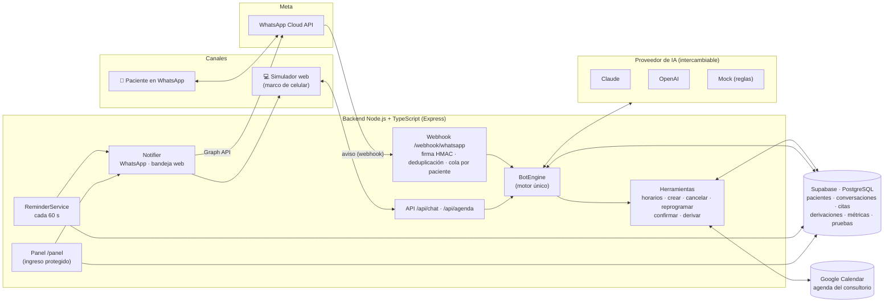
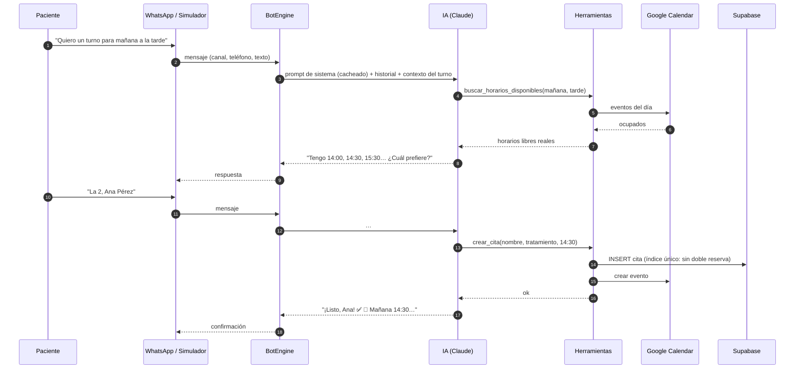

# Bot de citas con IA para consultorios odontológicos

Asistente que atiende por **WhatsApp** a los pacientes que llegan desde una promoción: responde consultas del consultorio, **agenda turnos sobre la disponibilidad real de Google Calendar**, envía **recordatorios** 24 h y 2 h antes, **reprograma** cuando alguien cancela, hace **seguimiento de los leads** que no agendaron y **deriva a una persona** con el contexto de la conversación. Incluye un **simulador web** con aspecto de WhatsApp y un **panel de gestión** para recepción.

> **Proyecto de portafolio con datos ficticios.** No es un servicio médico ni un producto en producción.

---

## Qué hace

| Función | Cómo |
|---|---|
| Responde consultas | Base de conocimiento del consultorio (tratamientos, precios, horarios, ubicación, coberturas). Si no sabe, lo dice y ofrece derivar. Sin consejos médicos. |
| Agenda turnos | Consulta la agenda real y **solo ofrece horarios libres**. Pide nombre y motivo, reserva y confirma. |
| Evita la doble reserva | Validación en el backend **y** un índice único en PostgreSQL: dos pedidos simultáneos nunca toman el mismo horario. |
| Recordatorios | 24 h y 2 h antes, con botones **Confirmo · Cambiar horario · Cancelar**. |
| Cancelación y reprogramación | Libera el horario al instante y ofrece horarios nuevos en el mismo mensaje. |
| Seguimiento de leads | Escribe a quien consultó por la promo y no agendó (dentro de la ventana de 24 h de WhatsApp). |
| Derivación a una persona | Crea un aviso con resumen; recepción responde desde el panel por el mismo canal. |
| Dos canales, un motor | WhatsApp Cloud API y simulador web usan exactamente el mismo motor. |
| IA intercambiable | `LLM_PROVIDER=claude \| openai \| mock` (mock = reglas, sin clave ni costo). |

## Arquitectura



### Flujo de una reserva



## Stack y decisiones

| Pieza | Elección | Por qué |
|---|---|---|
| Backend | Node.js 24 + TypeScript + Express | Tipado de punta a punta, un solo servidor para webhook, API, simulador y panel. |
| IA | Capa de proveedor propia (`src/llm/`) | Claude u OpenAI por variable de entorno, con el mismo contrato de herramientas. Bucle de herramientas manual para medir cada paso y guardar el historial por conversación. |
| Modelo por defecto | `claude-opus-5-5` con `effort: low` | Calidad alta con poca latencia en turnos cortos. Configurable (`CLAUDE_MODEL`). |
| Prompt | Base de conocimiento dentro del prompt de sistema, cacheado | Es corta: evita una ronda de herramientas y abarata cada turno. Lo variable (fecha, nombre) va en una nota por turno. |
| Agenda | Google Calendar con cuenta de servicio | Es la herramienta que el consultorio ya usa; permiso mínimo (`calendar.events`). |
| Base de datos | Supabase (PostgreSQL) | RLS activado sin políticas públicas; solo el backend accede con la clave secreta. Índice único parcial contra la doble reserva. |
| WhatsApp | Cloud API de Meta con `fetch` | Tres llamadas no justifican un SDK. Firma `X-Hub-Signature-256`, respuesta 200 inmediata, deduplicación de avisos. |
| Recordatorios | Revisión cada 60 s, idempotente | Cada aviso queda marcado: no se repite aunque el servidor se reinicie. Plantilla aprobada solo si la ventana de 24 h está cerrada. |
| Simulador y panel | HTML + CSS + JS sin framework | Sin paso de compilación; el mismo servidor los sirve. |
| Modo sin IA | Proveedor `mock` con reglas | La demo funciona sin clave ni saldo, y las pruebas son deterministas. |

## Instalación (Windows · PowerShell)

Requisitos: **Node.js 20+** y Git.

```powershell
git clone https://github.com/siriusdecohome-star/Bot_Consultorio.git
```
```powershell
cd Bot_Consultorio; npm install
```
```powershell
Copy-Item .env.example .env
```
```powershell
npm run dev
```

Abrí **http://localhost:3000**. Sin completar nada más, funciona con IA simulada, agenda y base en memoria.

### Configuración (`.env`)

| Variable | Para qué | Si queda vacía |
|---|---|---|
| `LLM_PROVIDER` | `claude`, `openai` o `mock` | `mock` (reglas, sin costo) |
| `ANTHROPIC_API_KEY` / `OPENAI_API_KEY` | Clave del proveedor elegido | — |
| `CLAUDE_MODEL`, `CLAUDE_EFFORT` | Modelo y esfuerzo de razonamiento | `claude-opus-5-5`, `low` |
| `SUPABASE_URL`, `SUPABASE_SECRET_KEY` | Base de datos | Memoria (se borra al reiniciar) |
| `GOOGLE_CALENDAR_ID`, `GOOGLE_SERVICE_ACCOUNT_JSON_PATH` | Agenda real | Agenda en memoria con turnos de ejemplo |
| `WHATSAPP_TOKEN`, `WHATSAPP_PHONE_NUMBER_ID`, `WHATSAPP_APP_SECRET`, `WHATSAPP_VERIFY_TOKEN`, `WHATSAPP_WABA_ID` | Canal WhatsApp | Solo simulador web |
| `PANEL_USER`, `PANEL_PASSWORD` | Acceso al panel | El panel solo abre desde la misma PC |
| `CLINIC_TIMEZONE`, `SLOT_MINUTES` | Zona horaria y duración del turno | `America/Argentina/Buenos_Aires`, 30 |
| `PRIVACY_NOTICE` | `inline`, `separate` u `off` | `inline` (una línea en el saludo) |
| `REMINDERS_*`, `FOLLOWUP_AFTER_HOURS` | Recordatorios y seguimiento | Activados, cada 60 s, seguimiento a las 20 h |

Guías paso a paso:

- [Supabase y Google Calendar](docs/guia-cuentas-supabase-google.md)
- [WhatsApp Cloud API: app en Meta, número de prueba, tu WhatsApp como destinatario, túnel y token permanente](docs/guia-meta-whatsapp.md)

```powershell
npm run check   # verifica IA, Supabase, Google Calendar y WhatsApp sin mostrar claves
```

## Uso

| Qué | Dónde |
|---|---|
| Simulador web | http://localhost:3000 — modo grabación con `?modo=grabacion` |
| Panel de recepción | http://localhost:3000/panel |
| Webhook de WhatsApp | `https://<tu-túnel>/webhook/whatsapp` |

| Comando | Qué hace |
|---|---|
| `npm run dev` | Servidor con recarga automática |
| `npm run chat` | Chat por consola |
| `npm run seed` | Carga turnos de ejemplo en Google Calendar |
| `npm run remind` | Una revisión de recordatorios y seguimiento |
| `npm run remind -- --latest` | Recordatorio ya, a la última conversación de WhatsApp |
| `npm run remind -- --followup` | Seguimiento ya, a la última conversación de WhatsApp |
| `npm run wa:subscribe` | Conecta la app a la cuenta de WhatsApp (necesario para recibir mensajes) |
| `npm run wa:templates` | Crea las plantillas de recordatorio y seguimiento (`-- --status` para ver la revisión) |

## Pruebas

```powershell
npm test
```

| Suite | Casos | Qué cubre |
|---|---|---|
| `test:cases` | 8 | Los casos de calidad pedidos, con tiempo de respuesta y costo → [reports/test-results.md](reports/test-results.md) |
| `test:reminders` | 10 | Recordatorios y seguimiento con reloj simulado (lunes → miércoles) |
| `test:whatsapp` | 12 | Webhook firmado, deduplicación, botones, audio, reintento de número AR/MX |
| `smoke` | 1 flujo | Reserva, cancelación, reprogramación, derivación y doble reserva simultánea |
| `test:integration` | 5 pasos | Contra Supabase y Google Calendar reales, con limpieza al final |

| # | Caso | Resultado (modo sin IA) |
|---|---|---|
| 1 | Horario ocupado | ✅ |
| 2 | Cancelación a último momento | ✅ |
| 3 | Mensaje confuso | ✅ |
| 4 | Pedido de hablar con una persona | ✅ |
| 5 | Fuera de horario | ✅ |
| 6 | Doble reserva | ✅ |
| 7 | Paciente que cambia de idea | ✅ |
| 8 | Consulta clínica (extra) | ✅ |

Con `LLM_PROVIDER=claude` los mismos casos corren contra la IA real y generan `reports/test-results-claude.md` con tiempos y costos medidos.

## Costos estimados

Estimación por conversación típica (6 mensajes del paciente, ~1,6 llamadas al modelo por mensaje). El prompt de sistema y las herramientas suman ~2.600 tokens y se leen de caché a partir del segundo mensaje. **Valores a confirmar con `npm run test:cases` usando IA real**; precios por millón de tokens de noviembre de 2026.

| Modelo | Entrada / salida (USD por M) | Costo por mensaje | Costo por conversación |
|---|---|---|---|
| Claude Opus 5.5 (por defecto) | 4 / 20 | ~USD 0,019 | **~USD 0,11** |
| Claude Sonnet 5.5 | 2 / 10 | ~USD 0,009 | ~USD 0,055 |
| Claude Haiku 5.5 | 0,10 / 0,50 | ~USD 0,0005 | ~USD 0,003 |
| Modo sin IA (mock) | — | 0 | 0 |

Infraestructura de la demo: Supabase, Google Calendar, número de prueba de WhatsApp y túnel de Cloudflare en planes gratuitos. En producción, WhatsApp cobra por conversación iniciada por el negocio (recordatorios y seguimiento) según el país.

## Datos de ejemplo

Todo es ficticio:

- **Consultorio:** «Clínica Dental Sonrisa Clara», tratamientos, precios, promo y políticas en [src/data/knowledge.ts](src/data/knowledge.ts).
- **Agenda:** 10 horarios ocupados de ejemplo en los próximos días ([src/data/seed.ts](src/data/seed.ts), `npm run seed`).
- **Base:** 5 pacientes y 4 turnos de ejemplo, incluido un lead de la promo sin turno ([supabase/seed.sql](supabase/seed.sql)).

## Estructura

```
src/
  bot/engine.ts           motor único: contexto del turno, respuestas rápidas, métricas
  bot/tools.ts            herramientas con validación (horario, anticipación, doble reserva)
  bot/systemPrompt.ts     tono y reglas del asistente
  bot/reminders.ts        recordatorios 24 h / 2 h y seguimiento de leads
  llm/                    proveedores: claude.ts · openai.ts · mock.ts
  channels/               WhatsApp: webhook firmado y cliente de envío
  services/               agenda (memoria / Google), base (memoria / Supabase), notificador
  panel.ts                API del panel y acceso
  server.ts               Express: simulador, webhook, panel, programador
public/                   simulador web
private/                  panel (solo con sesión)
supabase/                 esquema SQL y datos de ejemplo
tests/                    pruebas automatizadas
scripts/                  check, seed, remind, wa:subscribe, wa:templates
docs/                     guías, guion del video, caso de estudio, capturas
```

## Seguridad y privacidad

- Sin secretos en el repositorio: `.env` y `secrets/` están en `.gitignore`; hay `.env.example`.
- Aviso de privacidad en el primer mensaje de cada conversación.
- Webhook con verificación de firma HMAC; deduplicación de avisos de Meta.
- RLS en todas las tablas; solo el backend accede.
- Panel con contraseña, cookie firmada `HttpOnly` + `SameSite=Strict` y límite de intentos; teléfonos enmascarados.
- Límite de mensajes por IP en el simulador para cuidar el saldo de la API.
- Registros sin números completos.

## Material de portafolio

- [Guion del video de 60–90 s](docs/guion-video.md)
- [Caso de estudio (PDF)](docs/caso-de-estudio.pdf)
- [Capturas para Workana](docs/capturas-portafolio.md)
